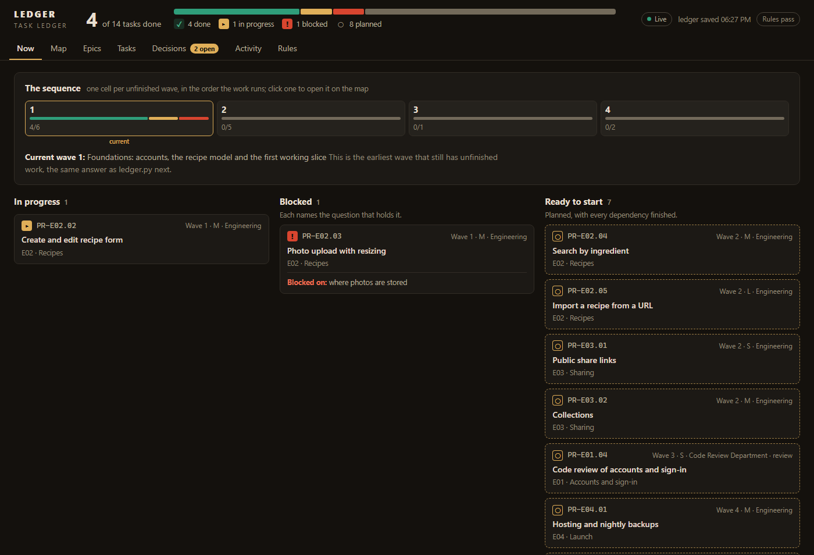

# ai-ledger

A task ledger for working with Claude Code across many sessions. The plan lives in version control as JSON, one
Python tool is the only thing allowed to change it, and every commit has to name the task it belongs to. A few
Claude Code hooks keep sessions honest about it.

It came out of a solo game project where Claude writes most of the code. It is opinionated and built around one
person (the "owner") who makes the calls, with Claude doing the work.

## The problems it solves

- **Every session starts from zero.** `ledger.py next` answers "where are we?" the same way in every session and on
  every machine: the current wave, what's in progress, what's blocked and on what, what's ready, and the one decision
  to ask you next.
- **"Done" with nothing behind it.** A task can't be marked done without evidence, labelled `ran-it`,
  `read-in-the-code` or `read-in-a-document`, saying what was observed. Each task's acceptance check has to be one
  that can fail.
- **Work that drifts out of scope.** Each task lists the files it may touch. A commit that names the task and touches
  anything else is refused unless it gives a reason, which is recorded. An audit reads the commit log and flags work
  that went around the tool.
- **Decisions lost in chat.** Open questions are first-class: each has 2 to 4 options with one recommended, tasks
  that need it can't start until it's ruled, and you answer them by clicking a button on a local web page.
- **Claude stopping early, or ignoring you.** A Stop hook won't let a session that is working the ledger end its
  reply while there's work it can do without you, or end with "I'll fix that next" and stop. A second hook tells
  Claude, after its next tool call, that you sent a message while it was working, and whether it's a question to
  answer now or an instruction to do now.
- **Subagents that overstep.** Reviews go to "department" agents with a fixed prompt and a hook that only lets them
  run seven read-and-report commands. They record findings; the main session routes each one to a fixing task or
  rejects it with a reason.

## What's in it

| Path | What it is |
|---|---|
| `Docs/Ledger/ledger.py` | The tool: `next`, `show`, `start`, `done`, `block`, `note`, `commit`, `check`, `selftest`, and the department commands. One file, standard library only |
| `Docs/Ledger/README.md` | The manual: every command, rule and refusal |
| `Docs/Ledger/epics/PR-E01.json` | An example epic: three tasks over two waves, a dependency, an open decision, a review subtask |
| `Docs/Ledger/meta.json` | Waves, conventions, departments, where the audit starts |
| `Docs/Ledger/ledger_web.py`, `web/` | A local web view (127.0.0.1 only): now, map, epics, tasks, decisions, commit activity. See "The ledger website" |
| `Docs/Ledger/Ledger Web.bat`, `ledger_web.sh` | Double-click (Windows) or run (macOS, Linux) to start the web view and open it in your browser |
| `Docs/Ledger/setup_ledger.py` | One-time setup: your id prefix, your name, git or Diversion |
| `Docs/Ledger/add_epic.py` | Adds an epic with its first task |
| `.claude/settings.json` | Registers the two session hooks |
| `.claude/hooks/ledger_stop.py` | Stop hook: no ending a reply while there's ledger work to do or a message unanswered |
| `.claude/hooks/owner_message_check.py` | PostToolUse hook: tells Claude you wrote while it was working |
| `.claude/hooks/department_fence.py` | Keeps department agents to their own commands |
| `.claude/agents/` | Two example departments: Code Review, Game Design |
| `CLAUDE.example.md` | The `CLAUDE.md` sections that go with it: ledger rules, working rules, subagent rules |
| `Docs/Ledger/review_graph_dump.py` | Unreal Engine projects only: dumps Blueprint graphs so a review agent without the editor can read them |

## How a day goes

1. Start a Claude Code session. It runs `ledger.py next` and says where things are.
2. If a decision is waiting, it asks you that one question. You answer in chat or on the web page.
3. It `start`s the next ready task, does the work, runs the task's acceptance check, and marks it `done` with what it
   saw. `ledger.py commit` makes the commit, stamped with the task id.
4. At the end of an epic, the main session dispatches a review to a department agent, which records findings. The
   main session files a fix task for each one that holds up, or rejects it with a reason.
5. `ledger.py check` is the gate: the ledger's rules, the rendered `LEDGER.md` up to date, and every commit since the
   audit started accounted for.

## The ledger website



*An example project (a small recipe-sharing app), not a real one.*

A local page for reading the ledger at a glance and answering decisions without opening a terminal.

- **Start it:** on Windows, double-click `Docs/Ledger/Ledger Web.bat`. On macOS or Linux, run
  `Docs/Ledger/ledger_web.sh`. Either one starts the server and opens http://127.0.0.1:8717 in your browser. Keep
  the window open while you use the page; closing it stops the server. If the server is already running, the `.bat`
  just opens the page.
- **Options:** `python Docs/Ledger/ledger_web.py --port 8800 --no-browser` picks another port and skips opening a
  tab, for example when you run two projects' ledgers at once.
- **What it shows:** *Now* (the current wave, what's in progress, blocked and ready), *Map* (every wave and its
  tasks), *Epics*, *Tasks*, *Decisions*, *Activity* (the commit log, each commit matched to its task) and *Rules*
  (any rule the ledger breaks, or "Rules pass").
- **Answering decisions:** each open decision shows its options with a button apiece. Your click goes to an inbox
  file, not the ledger; the next session's `ledger.py next` sees it and `ledger.py apply` makes it the ruling.
- **It follows the work:** the page reloads itself when a ledger file changes, so you can leave it open beside a
  running session.
- **It never changes the ledger.** It reads it through `ledger.py`, so "ready" and "current wave" are the tool's own
  answers. It listens on 127.0.0.1 only, so nothing outside your machine can reach it.

If `python` on your PATH is the Microsoft Store stub, put the full path to your Python in the `.bat`.

You can run several sessions at once: the ledger is one file per epic, saves only write what changed, and a save over
a file another session changed is refused rather than merged.

## Setup

You need Python 3.10+ and Claude Code. Git is the default version control; Diversion works too.

1. Copy `Docs/Ledger/`, `.claude/` and `.gitignore` into the root of your repository (merge `.claude/settings.json`
   and `.gitignore` with yours if you have them).
2. Copy the sections of `CLAUDE.example.md` you want into your `CLAUDE.md`.
3. Commit those files once, so the audit has a starting point.
4. Run setup with your own id prefix and name:

   ```
   python Docs/Ledger/setup_ledger.py --prefix APP --owner Alex
   ```

   Add `--drop-example` to remove the example epic, `--unreal` for an Unreal Engine project, `--vcs diversion` for
   Diversion.
5. Check it:

   ```
   python Docs/Ledger/ledger.py selftest
   python Docs/Ledger/ledger.py next
   python Docs/Ledger/ledger_web.py
   ```

6. Commit the result: `python Docs/Ledger/ledger.py commit --role Ledger --reason "set up the ledger" --message msg.txt Docs/Ledger/`
7. Start a new Claude Code session (hooks and agents are read when a session starts) and ask it to plan your first
   epic into the ledger.

**Windows:** the hooks and examples call `python`. If `python` on your PATH is the Microsoft Store stub, either
install Python properly or replace `python` with the full path to your interpreter in `.claude/settings.json` and in
the two agent files.

## Notes

- This is a workflow, not a product. Expect to adapt the departments, waves and rules to your project. The manual
  is long because each rule is there because something went wrong without it.
- The tool was used day to day with Diversion. The git backend is newer: it passes the selftest and an end-to-end run
  in a scratch repository, but has had less mileage.
- The commit audit needs the repository's history from the `auditFrom` commit on, so a shallow clone fails it.
- Nothing here talks to the network. The web view listens on 127.0.0.1 only.

## License

MIT. See `LICENSE`.
